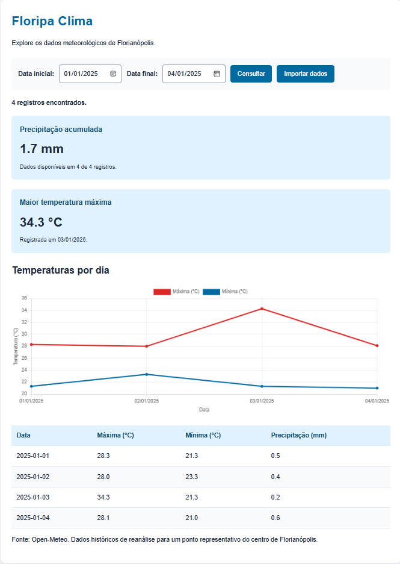
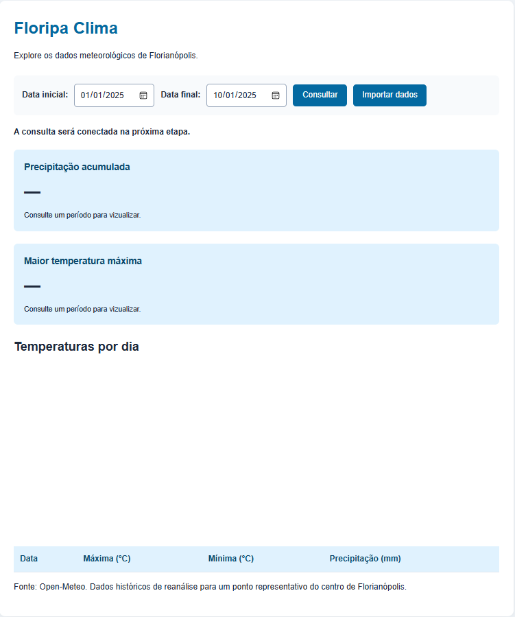

# Floripa Clima

Dashboard meteorológico de Florianópolis com ETL executado pelo site. A aplicação consulta dados públicos do Open-Meteo, organiza os registros diários, salva no PostgreSQL e apresenta filtros, indicadores, tabela e gráfico.

Projeto de aprendizagem em Python, integração de APIs, SQL, desenvolvimento web e execução com containers. O uso é local: não depende de hospedagem pública.

## Funcionalidades

- Importação de dados históricos por intervalo de datas.
- ETL iniciado pelo botão **Importar dados**.
- Consulta dos registros armazenados por período.
- Precipitação acumulada e quantidade de registros com dados disponíveis.
- Maior temperatura máxima do período e sua data.
- Gráfico de temperaturas máximas e mínimas por dia.
- Tabela dos registros consultados.
- Reimportação com atualização dos dados existentes, sem duplicar localidade, fonte e data.
- Validação de datas e tratamento de falhas de consulta e gravação.
- Criação e atualização da estrutura do banco com Alembic.
- Inicialização dos serviços pelo Docker Compose.

## Imagens da aplicação

### Dashboard com dados consultados

Consulta de 01/01/2025 a 04/01/2025, com indicadores, gráfico e tabela diária.



### Página antes da consulta

Tela inicial com filtros e botões de consulta e importação.



## Tecnologias

| Tecnologia | Uso |
|---|---|
| Python 3.14 | Backend e ETL |
| FastAPI e Uvicorn | Rotas HTTP e servidor da API |
| Requests | Consulta ao Open-Meteo |
| Psycopg | Consultas e gravação no PostgreSQL |
| SQLAlchemy e Alembic | Conexão das migrations e versionamento da estrutura do banco |
| uv | Gerenciamento das dependências e do ambiente Python |
| PostgreSQL 16 | Armazenamento persistente |
| Nginx | Entrega do frontend e proxy reverso para a API |
| Docker e Docker Compose | Construção e execução dos serviços |
| HTML, CSS e JavaScript | Interface e interação com a API |
| Chart.js | Gráfico de temperaturas |
| python-dotenv | Leitura de configurações locais |

O backend declara Python `>=3.14` em `backend/pyproject.toml`. A imagem do backend utiliza Python 3.14. As dependências resolvidas estão em `backend/uv.lock`.

## Arquitetura

| Serviço | Responsabilidade | Acesso |
|---|---|---|
| `frontend` | Nginx entrega HTML, CSS e JavaScript e encaminha `/clima`, `/importar` e `/saude` | `127.0.0.1:8080` |
| `backend` | FastAPI consulta o banco e executa o ETL | `127.0.0.1:8000` |
| `db` | PostgreSQL armazena os registros | `127.0.0.1:5433` no computador; `db:5432` na rede interna |
| `migrations` | Executa `alembic upgrade head` e encerra | Sem porta publicada |

O Compose aguarda o banco ficar saudável, executa as migrations e inicia o backend após sua conclusão com sucesso. O frontend inicia depois do container do backend.

O JavaScript consulta caminhos relativos, como `/clima`. O Nginx encaminha a requisição ao FastAPI, que acessa o PostgreSQL. A API não entrega mais os arquivos do frontend.

### Fluxo do ETL

1. **Extração:** `extrair_dados(inicio, fim)` consulta o histórico do Open-Meteo.
2. **Transformação:** `transformar_dados(dados)` organiza um registro por dia e calcula a amplitude térmica quando há máxima e mínima.
3. **Carga:** `salvar_registros(registros)` grava com `INSERT ... ON CONFLICT ... DO UPDATE`.

O fluxo do site passa diretamente da fonte para o banco. Não depende do JSON utilizado pelos scripts de terminal. A requisição de importação aguarda o ETL terminar antes de responder.

## Organização dos arquivos

| Caminho | Responsabilidade |
|---|---|
| `backend/api.py` | Rotas de saúde, consulta e importação |
| `backend/main.py` | Extração, transformação e coleta pelo terminal |
| `backend/carregar_dados.py` | Carga dos registros e importação de JSON pelo terminal |
| `backend/analise.py` | Análise do JSON local |
| `backend/schema.sql` | Referência SQL da estrutura inicial; não é executado na instalação com Compose |
| `backend/alembic.ini` | Configuração do Alembic |
| `backend/migrations/env.py` | Conexão e execução das migrations |
| `backend/migrations/versions/` | Histórico de alterações na estrutura do banco |
| `backend/pyproject.toml` | Informações e dependências do backend |
| `backend/uv.lock` | Versões resolvidas das dependências |
| `backend/Dockerfile` | Construção da imagem Python com uv |
| `frontend/index.html` | Estrutura da página |
| `frontend/style.css` | Estilos |
| `frontend/script.js` | Consultas, importações, indicadores e gráfico |
| `frontend/nginx.conf` | Arquivos estáticos e encaminhamento para a API |
| `frontend/Dockerfile` | Construção da imagem do frontend |
| `compose.yaml` | Definição dos quatro serviços e do volume padrão |
| `compose.override.yaml` | Ajuste local opcional; ignorado pelo Git |
| `.dockerignore` | Arquivos excluídos do contexto de construção |
| `.env` | Credenciais locais; ignorado pelo Git |
| `dados/clima_florianopolis.json` | Dados gerados pela coleta de terminal |
| `docs/` | Imagens deste README |

## Pré-requisitos

Para executar tudo com Docker:

- Docker Desktop iniciado, com containers Linux e Docker Compose disponível.
- Internet para baixar imagens e dependências, consultar o Open-Meteo e carregar o Chart.js pelo CDN.
- Git, caso utilize a clonagem pelo terminal.

Não é necessário instalar Python, uv, Nginx ou PostgreSQL no computador para a execução completa em containers. O pgAdmin é opcional.

Os exemplos abaixo usam PowerShell no Windows.

## Instalação e primeira execução

### 1. Clonar o repositório

```powershell
git clone https://github.com/VictorDiasQueiroz12/Floripa-Clima.git
cd Floripa-Clima
```

### 2. Criar o `.env`

Na raiz, ao lado de `compose.yaml`, crie um arquivo `.env`:

```dotenv
POSTGRES_USER=floripa
POSTGRES_PASSWORD=troque_por_uma_senha_local
POSTGRES_DB=floripa_clima
```

Escolha uma senha antes da primeira inicialização. O exemplo fica neste README; não é necessário um `.env.example` separado.

O Compose fornece `POSTGRES_HOST=db` e `POSTGRES_PORT=5432` ao backend e às migrations. Quando executado diretamente no Windows, o Python usa por padrão `127.0.0.1:5433`.

Mantenha no `.gitignore`:

```gitignore
.venv/
__pycache__/
.env
compose.override.yaml
```

### 3. Construir e iniciar

Abra o Docker Desktop e, na raiz do repositório, execute:

```powershell
docker compose config --quiet
docker compose up --build -d
```

Na primeira execução, o Compose cria o volume do banco e o Alembic cria a estrutura automaticamente. **Não execute `schema.sql` manualmente nesse fluxo.**

Confira os serviços:

```powershell
docker compose ps -a
```

| Serviço | Estado esperado |
|---|---|
| `db` | Up e healthy |
| `migrations` | Exited (0) |
| `backend` | Up |
| `frontend` | Up |

`migrations` terminar com código zero indica sucesso: esse serviço não precisa permanecer executando.

### 4. Acessar

| Endereço | Função |
|---|---|
| [http://127.0.0.1:8080/](http://127.0.0.1:8080/) | Dashboard |
| [http://127.0.0.1:8000/docs](http://127.0.0.1:8000/docs) | Documentação interativa da API |
| [http://127.0.0.1:8080/saude](http://127.0.0.1:8080/saude) | Resposta de saúde pelo Nginx |
| [http://127.0.0.1:8000/clima](http://127.0.0.1:8000/clima) | Dados em JSON diretamente pela API |

Abrir `/` na porta 8000 retorna 404: a página é servida pelo Nginx na porta 8080. A documentação `/docs` é acessada diretamente na porta 8000.

### 5. Importar e consultar

1. Selecione um período, por exemplo **01/01/2025 a 10/01/2025**.
2. Clique em **Importar dados** e espere a conclusão.
3. Clique em **Consultar** para atualizar tabela, cartões e gráfico.
4. Reimporte o mesmo período para verificar que a quantidade de registros não aumenta.

O banco novo começa vazio. Consultar não importa dados. Durante a importação, o painel mantém o resultado anterior até a próxima consulta.

## Volumes e configuração local

O `compose.yaml` padrão declara:

```yaml
volumes:
  postgres_data: {}
```

O serviço `db` monta esse volume em `/var/lib/postgresql/data`. O nome físico é definido pelo Compose a partir do nome do projeto.

Para uma instalação nova, **não crie um override**. O volume será criado automaticamente.

Quem já possui dados em outro volume pode utilizar `compose.override.yaml` para referenciar um volume externo existente. Esse ajuste é específico do computador e não vai para o GitHub. Os comandos comuns do Compose carregam o override automaticamente quando ele existe na raiz.

O override não copia os dados: ele seleciona o volume. Não reutilize o volume de outro ambiente para um teste de banco vazio. Antes de alterar um volume existente, identifique seu conteúdo e faça backup.

As credenciais do PostgreSQL são configuradas na primeira inicialização de um volume vazio. Mudar a senha no `.env` não muda a senha de um banco já inicializado.

## Comandos do dia a dia

```powershell
# Inicia os serviços existentes.
docker compose up -d

# Reconstrói as imagens após mudanças no código ou nas dependências.
docker compose up --build -d

# Mostra o estado, incluindo o serviço de migrations encerrado.
docker compose ps -a

# Mostra os logs recentes.
docker compose logs --tail 80 backend migrations frontend

# Para os serviços e preserva os dados.
docker compose stop

# Remove os containers e a rede, preservando o volume padrão.
docker compose down
```

O código é copiado para as imagens no build. Alterações nos arquivos locais exigem reconstrução da imagem correspondente. Depois, atualize o navegador com Ctrl + F5 se necessário.

`docker compose down -v` pode remover o volume gerenciado pelo Compose e apagar o banco. Não use esse comando como encerramento comum.

## Migrations com Alembic

A primeira revisão, `4e5f2211361d`, cria `public.weather_daily`. O serviço `migrations` aplica as revisões pendentes com `upgrade head` antes da inicialização do backend.

Com os serviços funcionando:

```powershell
# Consulta a revisão registrada no banco.
docker compose exec backend alembic -c /app/backend/alembic.ini current
```

Para desenvolver uma nova migration, com uv instalado, execute a partir da raiz:

```powershell
cd backend
uv run alembic revision -m "descricao da alteracao"
cd ..
```

Preencha e revise `upgrade()` e `downgrade()` no arquivo gerado. O projeto utiliza migrations escritas manualmente; `target_metadata=None` não fornece modelos para autogeração.

Depois, reconstrua e inicie os serviços para executar a nova revisão:

```powershell
docker compose up --build -d
```

O comando `stamp` apenas registra uma revisão, sem criar tabelas. Foi utilizado na adoção do banco antigo após conferência da estrutura; **não faz parte da instalação de um banco vazio nem substitui futuras migrations**. Um downgrade que remove uma tabela também remove seus registros.

## Desenvolvimento com uv

O uv é necessário apenas para executar ou desenvolver o Python fora dos containers. As dependências são definidas no `pyproject.toml` e resolvidas no `uv.lock`; o projeto não usa mais `requirements.txt`.

Na raiz:

```powershell
uv sync --project backend --locked
```

O ambiente fica em `backend/.venv` e não deve ser versionado. Para adicionar uma dependência:

```powershell
uv add --project backend nome-da-biblioteca
```

Versione tanto `pyproject.toml` quanto `uv.lock`.

### Scripts de terminal

Com o banco disponível na porta 5433 e as credenciais no `.env`:

```powershell
# Consulta o período definido em executar_coleta() e salva o JSON.
uv run --project backend python -m backend.main

# Analisa o JSON local.
uv run --project backend python -m backend.analise

# Importa o JSON local no PostgreSQL.
uv run --project backend python -m backend.carregar_dados
```

O JSON é substituído a cada coleta pelo terminal e não é atualizado pela importação do site. Assim, a análise desse arquivo pode representar um período diferente do dashboard.

### Executar a API no Windows

Para desenvolvimento do backend fora do Docker, libere primeiro sua porta:

```powershell
docker compose stop frontend backend
uv run --project backend python -m uvicorn backend.api:app --reload
```

Essa execução disponibiliza a API e `/docs` na porta 8000, sem servir o frontend. Para voltar ao fluxo completo, encerre o Uvicorn com Ctrl + C e execute `docker compose up -d`.

## Rotas

| Método | Rota | Responsável e finalidade |
|---|---|---|
| GET | `/` | Nginx entrega o HTML na porta 8080 |
| GET | `/static/...` | Nginx entrega CSS e JavaScript na porta 8080 |
| GET | `/saude` | API indica que está respondendo; não testa o banco |
| GET | `/clima` | API consulta registros; `inicio` e `fim` são opcionais |
| POST | `/importar` | API executa o ETL; `inicio` e `fim` são obrigatórios |
| GET | `/docs` | Documentação interativa, diretamente na porta 8000 |

Exemplo de consulta pelo Nginx:

```text
http://127.0.0.1:8080/clima?inicio=2025-01-03&fim=2025-01-07
```

Para testar a importação na documentação, use **POST /importar → Try it out → Execute**. Abrir uma URL pela barra do navegador envia GET e não executa a importação.

### Validações

- Data inicial anterior ou igual à final.
- Data final da importação anterior ao dia atual do servidor.
- Até 366 dias por importação.
- Formato de datas validado pelo FastAPI.

Dados históricos muito recentes podem não estar disponíveis na fonte.

## Banco e indicadores

| Campo | Tipo e regra |
|---|---|
| `id` | Inteiro, identidade gerada sempre e chave primária |
| `localidade` | Texto obrigatório |
| `fonte` | Texto obrigatório |
| `data` | Data obrigatória |
| `temperatura_maxima` e `temperatura_minima` | `NUMERIC(5, 1)`, permitem NULL |
| `precipitacao` | `NUMERIC(8, 2)`, permite NULL e não aceita valores negativos |
| `criado_em` | Timestamp com fuso, obrigatório e com padrão CURRENT_TIMESTAMP |

Há uma chave única para localidade, fonte e data, e uma restrição para máxima maior ou igual à mínima quando ambas estão disponíveis.

A amplitude térmica é **máxima − mínima**, calculada na consulta sem coluna adicional no banco. A precipitação acumulada considera apenas valores disponíveis. A cobertura exibida refere-se aos registros retornados, não garante a presença de todos os dias solicitados. O gráfico mantém valores ausentes como lacunas.

Em caso de empate na maior máxima, o painel mantém o primeiro registro encontrado na ordenação por data.

## Verificações manuais

| Teste | Resultado esperado |
|---|---|
| Iniciar em banco vazio | Migration cria a tabela e registra a revisão |
| Importar e consultar 01 a 10/01/2025 | Dez registros |
| Reimportar o mesmo período | Sem aumento da quantidade de linhas |
| Consultar 03 a 07/01/2025 | Cinco registros; 3,4 mm nos dados utilizados no desenvolvimento |
| Consultar 01 a 10/01/2025 | 13,6 mm; maior máxima de 34,3 °C em 03/01, nos dados utilizados no desenvolvimento |
| Informar datas invertidas | Mensagem de validação |
| Consultar período sem dados | Mensagem de nenhum registro encontrado |
| Alterar o período | Tabela, cartões e gráfico acompanham o filtro |
| Parar e iniciar os serviços | Registros preservados |

Os exemplos numéricos podem mudar caso a fonte revise os dados.

### Testar um ambiente separado

Pare o ambiente atual para liberar suas portas e use um nome de projeto diferente. O `-f compose.yaml` seleciona apenas a configuração padrão, sem o override local:

```powershell
docker compose stop
docker compose -p floripa-clima-teste -f compose.yaml up --build -d
docker compose -p floripa-clima-teste -f compose.yaml ps -a
```

No primeiro uso desse ambiente de teste, seu volume estará vazio. Nas próximas execuções, o volume de teste será reutilizado. Confira a importação e a consulta no navegador. Para voltar:

```powershell
docker compose -p floripa-clima-teste -f compose.yaml down
docker compose up -d
```

## Solução de problemas

| Problema | O que conferir |
|---|---|
| Docker não conecta | Docker Desktop iniciado |
| Porta já está em uso | Uvicorn local ou outro projeto ocupando 8000, 8080 ou 5433 |
| Migrations falham | `docker compose logs --tail 80 migrations`; banco, credenciais e histórico de revisões |
| Consulta ou importação retorna 503 | `docker compose logs --tail 80 backend` |
| Importação tenta conectar em 127.0.0.1:5433 dentro do container | `api.py` e `carregar_dados.py` devem ler POSTGRES_HOST e POSTGRES_PORT; reconstruir a imagem |
| Nginx retorna 502 | Backend disponível; verificar logs de frontend e backend e reiniciar frontend se necessário |
| Página retorna 404 na porta 8000 | Usar o dashboard na porta 8080 |
| CSS ou JavaScript retorna 404 | Arquivos copiados e caminho `/static/` configurado no Nginx |
| Gráfico não aparece | Chart.js acessível pelo CDN, ordem dos scripts e id `grafico-temperaturas` |
| Alterações não aparecem | Reconstruir a imagem correspondente e atualizar com Ctrl + F5 |
| Importação retorna 502 pela API | Falha da fonte externa ou resposta não processável; consultar logs |
| Volume externo não encontrado | Override aponta para um volume específico de outro computador |

## Fonte e limitações

Fonte: [Open-Meteo Historical Weather API](https://open-meteo.com/en/docs/historical-weather-api).

Ponto consultado: latitude **-27.5954**, longitude **-48.5480**. Fuso solicitado: **America/Sao_Paulo**.

O histórico é baseado em **reanálise**, combinando modelos e observações. Não representa diretamente uma medição de estação nesse ponto nem dados específicos de cada bairro.

Dados disponibilizados pelo Open-Meteo sob [CC BY 4.0](https://creativecommons.org/licenses/by/4.0/). Consulte os [termos do serviço](https://open-meteo.com/en/terms) para as condições de acesso à API. A licença dos dados não define a licença do código deste repositório.

A aplicação é local e educacional. Não possui autenticação, agendamento, fila de tarefas ou histórico persistente de execuções do ETL. A importação é síncrona e consultas não possuem paginação. As portas publicadas ficam restritas a `127.0.0.1` na configuração atual.

## Próximas melhorias

- Histórico de execuções do ETL.
- Gráfico diário de precipitação.
- Exportação CSV.
- Verificação da cobertura de dias do período solicitado.
- Testes automatizados de transformação, rotas e importação.

## Autor

Desenvolvido por **Victor Dias Queiroz** como projeto de aprendizagem em programação, integração de sistemas e análise de dados.
